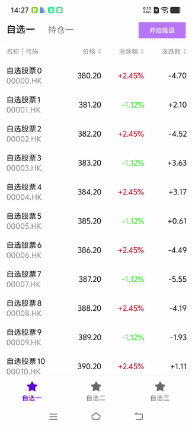
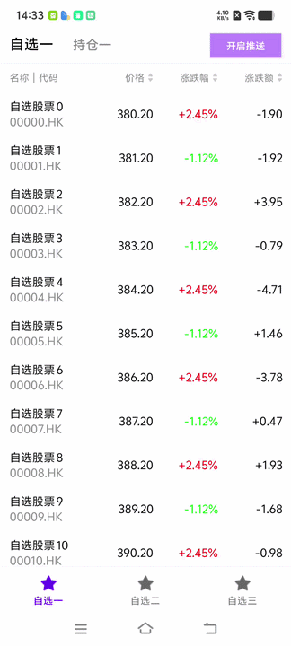
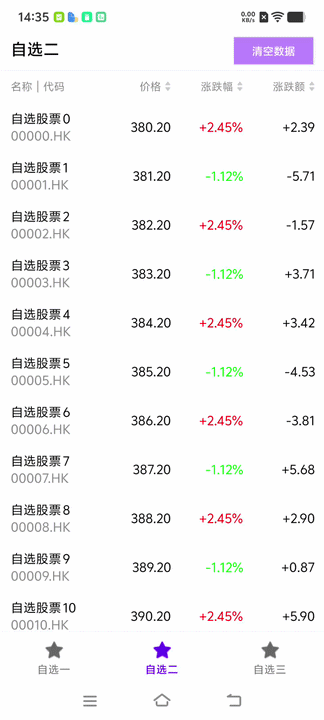
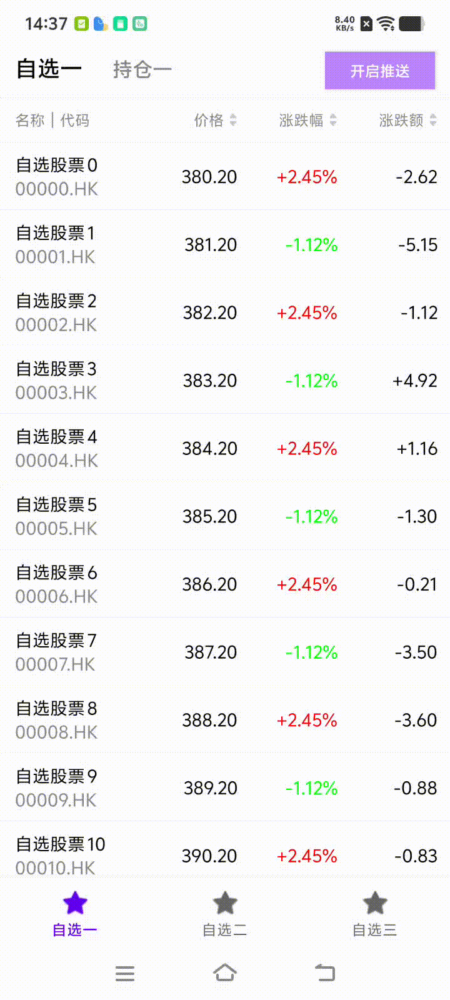
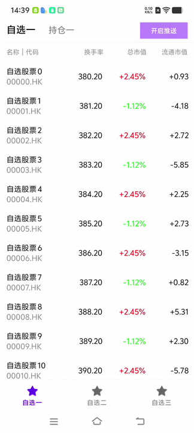
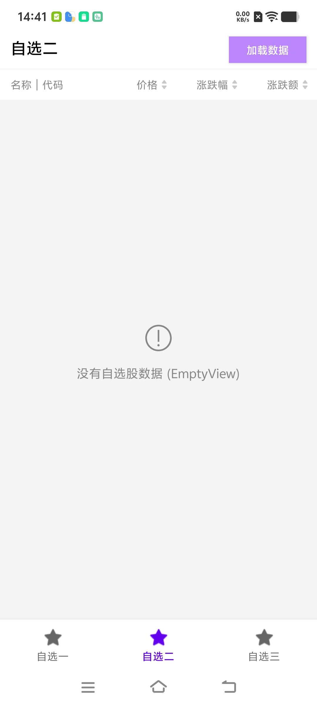
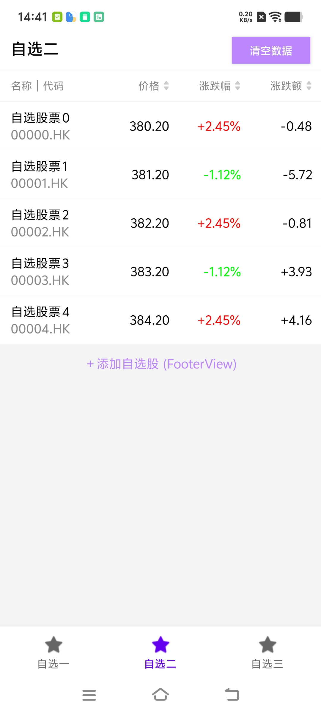

# FrozenColumnList

[](https://jitpack.io/#viifo/FrozenColumnList)

[中文](README.md) | [English](README_EN.md)

A multi-column RecyclerView for stock watchlists and quote tables. `FrozenColumnList` supports:

- Freezing the first, middle, or last n columns.
- Independent or mirrored scrolling on either side of middle frozen columns.
- Drawing ordinary text columns in shared scrolling Views while keeping frozen TextViews.
- Separate side backgrounds and selection, with native styling for frozen columns.
- Synchronized headers, sorting callbacks, DiffUtil updates, EmptyView and FooterView.
- Horizontal overscroll/rebound in START / END mode, refresh layouts and ViewPager2 integration.

```kotlin
implementation("com.github.viifo:FrozenColumnList:2.2.0")
```

Add `maven { url = uri("https://jitpack.io") }` to your dependency repositories.

## Demo and preview

Download [APK-Demo](https://github.com/viifo/FrozenColumnList/releases). List 3 demonstrates middle frozen
columns; list 4 demonstrates trailing frozen columns and initial scroll direction. All four lists use grouped text rendering.

| Sliding effect | Horizontal rebound |
| :---: | :---: |
|  |  |
| **Refresh layout 1** | **Refresh layout 2** |
|  |  |
| **Item update animation** | **ViewPager integration** |
|  |  |
| **EmptyView** | **FooterView** |
|  |  |

## Migration from 1.x

Version 2.0 replaces the per-column create/bind API with complete-row creation and binding.
Create or inflate each row once, then cache its child references in a custom ViewHolder if needed.
The separate middle-frozen components have been merged into `FrozenColumnList` and `FrozenColumnHeader`.

For a traditional `ColumnProvider`, every direct child of the row must represent one logical column,
in data order. Set natural widths in XML or `createItemRowView`. Middle-frozen rows must use
`MiddleFrozenRowLayout`; START / END rows can use a horizontal ViewGroup. The optional text provider
below uses logical columns rather than one child per column.

## Frozen-column configuration

```kotlin
val config = FrozenColumnConfig(
    frozenColumnCount = 1,
    frozenColumnPosition = FrozenColumnPosition.MIDDLE,
    middleColumnStart = 7, // null selects a centered range
    visibleColumnCount = 5, // two left + one frozen + two right
    scrollMode = FrozenColumnScrollMode.INDEPENDENT,
    horizontalScrollThreshold = resources.getDimensionPixelSize(R.dimen.horizontal_threshold)
)
stockList.setColumnConfig(config)
stockList.setProvider(provider)
stockHeader.setProvider(provider)
stockList.attachHeader(stockHeader) // also applies the configuration to the header
stockHeader.setHeaderData(headers)
stockList.submitList(items)
```

`START` freezes the first n columns; `MIDDLE` freezes the specified middle range; `END` freezes the
last n columns. In middle mode, `SYNCHRONIZED` is mirrored: the sides move in opposite visual directions,
approaching or moving away from the frozen range together.

`visibleColumnCount` includes frozen columns and must be larger than their count. In MIDDLE mode the
remaining count must be even. Frozen widths stay unchanged; ordinary columns divide the remaining
viewport equally. Without this option, all columns retain their natural widths. Headers and rows
should use the same order and natural widths.

### Initial scroll direction

In START / END mode, `initialScrollSide` selects which end of the ordinary columns is initially
visible, independently of the frozen column position. The default `LEFT` shows the leftmost ordinary
columns; choose `RIGHT` to show the rightmost ordinary columns:

```kotlin
stockList.setColumnConfig(FrozenColumnConfig(
    frozenColumnCount = 1,
    frozenColumnPosition = FrozenColumnPosition.END,
    visibleColumnCount = 4,
    initialScrollSide = FrozenColumnSide.RIGHT
))
```

The chosen edge applies after the first data layout and `resetHorizontalOffsets()`. Alignment waits
for the column widths. Changing `initialScrollSide` also resets to that edge; ordinary data updates
preserve manual scrolling. With data already loaded, changing the frozen range or visible column count
always shows the ordinary columns adjacent to the new frozen range, independently of `initialScrollSide`:
the rightmost ordinary columns for END and the leftmost ordinary columns for START, keeping the visible
column sequence continuous across the frozen boundary.
`updateHorizontalOffset(0)` scrolls to the left edge. Headers synchronize automatically for both XML
and text rows. MIDDLE mode ignores this setting and initially shows the columns adjacent to the frozen range on both sides.

Demo list 4 initially freezes one column and shows the right edge. Its switch changes the initial
scroll direction. The frozen-count button cycles through 1 → 2 → 3 → 1, realigning ordinary columns with the frozen range.

## Grouped text rendering

`TextColumnProvider` draws ordinary columns in one View per scrolling region, reducing the number of
TextViews per row. Use `ColumnProvider` or `DefaultColumnProvider` for custom View rows.

A 15-column row with one frozen middle column has:

```text
FrozenTextRowLayout
├── FrozenRowTextView: seven left columns
├── TextView: one native frozen column
└── FrozenRowTextView: seven right columns
```

This is three content Views, or four including the row container. Headers use the same structure.
START / END with one frozen column uses two content Views. Multiple frozen columns each retain a
native TextView; scrolling columns still share one View per region.

```kotlin
class TextQuoteProvider : TextColumnProvider<Quote>() {
    override fun getHeaderColumns(
        context: Context,
        data: List<FrozenHeaderData>
    ): List<FrozenTextColumn> = data.mapIndexed { index, header ->
        FrozenTextColumn(
            id = index + 1,
            width = context.dp2px(if (index == 7) 96 else 86),
            text = header.name.orEmpty(),
            textSizeSp = 12f
        )
    }

    override fun getItemColumns(context: Context, data: Quote): List<FrozenTextColumn> =
        data.values.mapIndexed { index, value ->
            FrozenTextColumn(
                id = index + 1,
                width = context.dp2px(if (index == 7) 96 else 86),
                text = value
            )
        }

    override fun styleFrozenColumnView(view: TextView, columnIndex: Int, header: Boolean) {
        view.setBackgroundColor(Color.WHITE)
        view.elevation = view.context.dp2px(8).toFloat()
    }
}
```

`dp2px` is a dimension conversion extension used in the Demo. Widths and padding are pixels; text
sizes are sp. IDs must be unique within a row and should remain stable. `secondaryText` supports a
second line such as a stock code. Columns support colors, alignment, backgrounds, end drawables,
and ellipsis. `styleFrozenColumnView` runs after binding so native backgrounds, corners, and elevation
can be reapplied after reuse or configuration changes.

Text layouts are cached per column. Unchanged fields retain their layouts, including payload updates.
Override `getChangePayload` to supply update markers; side-selection backgrounds use a separate payload.

```kotlin
stockList.setOnColumnClickListener { view, rowPosition, columnIndex, columnId ->
    val row = view as FrozenTextRowLayout
    val visibleBounds = Rect()
    if (row.getColumnBoundsById(columnId, visibleBounds)) {
        // Visible bounds in row-local coordinates: use for a highlight or popup anchor.
    }
}
```

`columnAt(x, y)` returns a logical column index in row coordinates. `getColumnBounds(index, outRect)`
and `getColumnBoundsById(id, outRect)` return clipped visible bounds; invisible columns return false
and clear the rectangle. Drawing and hit testing share geometry after scrolling and reconfiguration.
The text regions expose individual virtual accessibility nodes.

Scrolling columns have no individual View. Access them through `updateColumn`, `getColumnById`, and
column callbacks; `findViewById` and `getColumnView<TextView>` cannot retrieve them. Access native frozen
columns with `getFrozenColumnView`. Text rows support item/side callbacks, double taps, selection,
header clicks/sorting, rebound, EmptyView and FooterView. Header click positions are logical column indices;
the callback View for a scrolling text column is the row container. Column callbacks, like item clicks,
fire immediately; side single clicks are delayed when a side double-click listener is installed.

The Demo's `StockItemAnimator` demonstrates price-change highlights for text columns.
The 15-column XML layouts serve as examples for custom View rows.

## Traditional row XML and ViewHolder

Traditional providers remain useful for arbitrary child controls or custom per-cell Views.
For a middle-frozen row:

```xml
<com.viifo.frozencolumnlist.layout.MiddleFrozenRowLayout
    xmlns:android="http://schemas.android.com/apk/res/android"
    android:layout_width="match_parent"
    android:layout_height="wrap_content">
    <TextView
        android:id="@+id/left_amount"
        android:layout_width="86dp"
        android:layout_height="48dp" />
    <TextView
        android:id="@+id/strike_price"
        android:layout_width="96dp"
        android:layout_height="48dp"
        android:background="@color/white"
        android:elevation="8dp"
        android:textStyle="bold" />
    <TextView
        android:id="@+id/right_amount"
        android:layout_width="86dp"
        android:layout_height="48dp" />
</com.viifo.frozencolumnlist.layout.MiddleFrozenRowLayout>
```

Implement `ColumnProvider` directly for a custom cached ViewHolder, or extend `DefaultColumnProvider`:

```kotlin
class QuoteProvider : DefaultColumnProvider<Quote>() {
    override fun createHeaderRowView(parent: ViewGroup, columnCount: Int): ViewGroup =
        LayoutInflater.from(parent.context)
            .inflate(R.layout.header_quote_row, parent, false) as ViewGroup

    override fun createItemRowView(parent: ViewGroup, viewType: Int, columnCount: Int): ViewGroup =
        LayoutInflater.from(parent.context)
            .inflate(R.layout.item_quote_row, parent, false) as ViewGroup

    override fun bindHeaderRow(holder: FrozenHeaderViewHolder, data: List<FrozenHeaderData>) {
        data.forEachIndexed { index, header ->
            holder.getColumnView<TextView>(index).text = header.name
        }
    }

    override fun bindItemRow(holder: FrozenColumnViewHolder<Quote>, data: Quote, payloads: List<Any?>) {
        holder.getView<TextView>(R.id.strike_price).text = data.strikePrice
    }
}
```

Override `bindHeaderColumn` if an individual header refresh also needs to update a sorting drawable.
The default implementation updates its text. A custom `FrozenColumnViewHolder` exposes `rowView` and
`bind(data, payloads)`; `FrozenHeaderViewHolder` also exposes `bindColumn(position, data)`.

## Side backgrounds, selection and sorting

Override `getSideBackgroundColor(context, data, side, selected)` to provide ordinary and selected colors.
Use transparent ordinary cell backgrounds when the row's side background should show through.
Selection is stored by data ID so it survives recycling and reordering.

```kotlin
stockList.setOnSideClickListener { _, position, side -> /* single tap */ }
stockList.setOnSideDoubleClickListener { _, position, side ->
    stockList.toggleSideSelected(position, side)
}
stockHeader.onHeaderItemClickListener = { _, columnIndex ->
    // Sort the data and call refreshHeader(columnIndex, updatedHeader) for the indicator.
}
```

## Refresh layout and ViewPager2

Place `FrozenColumnList` inside `SmartRefreshLayout` as a normal RecyclerView. Middle-mode gestures
lock horizontally only after the configured threshold, reducing false horizontal drags during quick
vertical scrolling. The Demo disables SmartRefreshLayout nested scrolling to avoid horizontal gesture
competition. Use `setupViewPager2TouchConflictResolution(true)` for ViewPager2 integration.

## Common APIs

- `setColumnConfig`, `setProvider`, `attachHeader`, `submitList`
- `resetHorizontalOffsets`, `updateHorizontalOffset` (START / END), `updateHorizontalOffsets` (MIDDLE)
- `setOnItemClickListener`, `setOnItemChildClickListener`, `addChildClickViewIds`
- `setOnColumnClickListener` (logical text columns)
- `setOnSideClickListener`, `setOnSideDoubleClickListener`
- `setSideSelected`, `toggleSideSelected`, `clearSideSelection`
- `setSpringBackAnimatorProvider`, `setItemAnimator`, `addItemDecoration`
- `setupViewPager2TouchConflictResolution`
- Header: `setHeaderData`, `refreshHeader`, `onHeaderItemClickListener`

## Changelog

### v2.2.0

- Add `TextColumnProvider` and `FrozenTextColumn` to draw ordinary columns by scrolling region while
  retaining frozen TextViews in START, MIDDLE and END modes.
- Support two-line text, end drawables, per-column accessibility and layout caching, with logical
  column click callbacks and visible-bounds queries.
- Add `initialScrollSide` to select the initial left or right edge in START / END mode;
  `resetHorizontalOffsets()` restores the configured edge.
- Align ordinary columns with the frozen range after frozen-range or visible-count changes,
  keeping headers and rows synchronized.
- Fix header width fitting during measurement and right-edge offsets after data loading or resizing.
- Switch all four Demo lists to text providers, adapt price-change highlights and add an initial
  scroll direction switch to list 4.

### v2.1.0

- Add END mode, runtime changes to trailing frozen-column counts, and matching header/row scroll ranges.
- Fix fitted widths during initial layout and recycling, and header clipping after configuration changes.
- Support trailing-mode overscroll dividers and add the fourth Demo with reversed columns.

### v2.0.0

- Introduce shared frozen-column configuration and middle-mode independent/mirrored scrolling.
- Introduce complete-row providers and custom ViewHolders, fitted visible column counts, side selection,
  single/double taps and independent backgrounds.
- Fix offset restoration, clipping during reuse, and gesture direction detection.

### v1.0.0

- Leading frozen columns, synchronized headers and sorting callbacks, horizontal rebound, DiffUtil updates,
  item animations, dividers, empty/footer views and refresh/ViewPager2 integration.

## License


```
Copyright 2021 viifo

Licensed under the Apache License, Version 2.0 (the "License");
you may not use this file except in compliance with the License.
You may obtain a copy of the License at

   http://www.apache.org/licenses/LICENSE-2.0

Unless required by applicable law or agreed to in writing, software
distributed under the License is distributed on an "AS IS" BASIS,
WITHOUT WARRANTIES OR CONDITIONS OF ANY KIND, either express or implied.
See the License for the specific language governing permissions and
limitations under the License.
```
